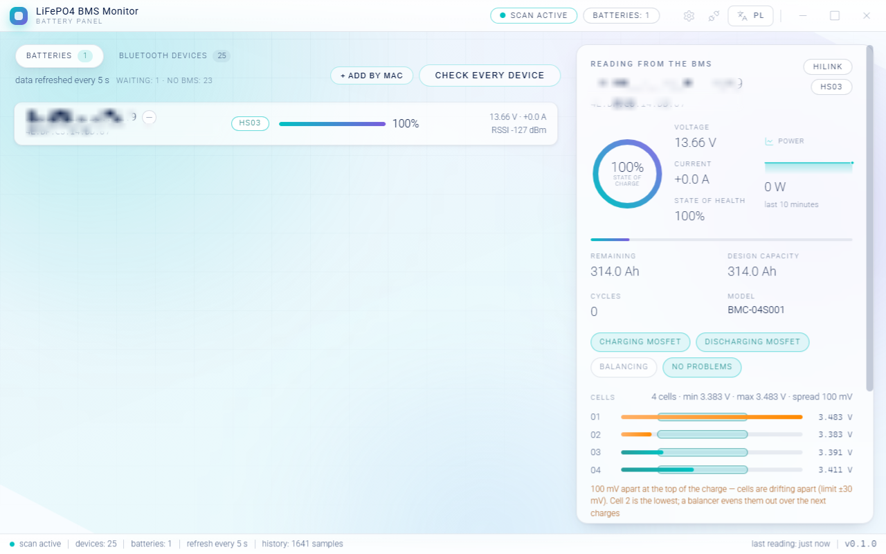
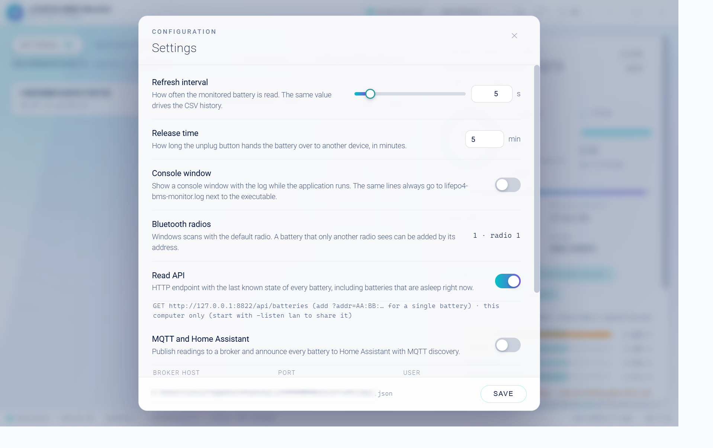

# LiFePO4 BMS Monitor

Read-only Bluetooth LE monitor for LiFePO4 battery management systems (BMS).
It scans for nearby batteries, lists them in a desktop application and shows the
live state of the battery you point at — state of charge, voltage, current,
cells, temperatures and MOSFET/balancer state — refreshing every few seconds.

The application never writes settings to a battery: every frame it sends is a
read request.



* Desktop application: Go + WebView2, frameless window with its own title bar, bilingual UI (English / Polish)
* Two tabs on the left: **Batteries** (everything that answers) and **Bluetooth devices** (everything the scan sees), each with a count
* Title bar: drag, resize from every edge, and an *unplug* button that releases the battery to another device for the configured number of minutes
* Detail panel: state of charge, voltage, current, charging power with a graph of the last ten minutes, estimated time to full (or empty), cells, temperatures and MOSFET state
* Cell balance: a band on the cell bars shows the window every cell should stay in, cells outside it are highlighted, and the spread is explained — including why a spread in the flat part of the curve is a *phantom* imbalance (see below)
* Settings panel: refresh interval, release time, Bluetooth radios, read API, MQTT with Home Assistant discovery
* Command line tool: Python TUI for quick checks and reports (`cli/`)
* Battery data and history are stored per user in `%APPDATA%\LiFePO4BMSMonitor`

Battery serial numbers, Bluetooth addresses and the Windows user name are masked
in the screenshots, and the JSON examples below use placeholder values.



## Supported batteries

Detection is vendor neutral: a device is identified by the protocol it speaks,
not by its advertised name. The name is only a hint that decides the order in
which devices are checked.

| Family | Service / characteristics | Devices seen in the wild |
|---|---|---|
| HS03 / HiLink | `0x0001`, write `0x0002`, notify `0x0003` | Humsienk, ECO-WORTHY, DCH and similar 4S/8S packs |
| HS04 / WATT | `0xFFF0`, notify `0xFFF1`, write `0xFFF2`, auth `0xFFFA` | Humsienk "WATT" generation packs |
| JBD / Xiaoxiang | `0xFF00`, notify `0xFF01`, write `0xFF02` | Overkill Solar, JBD "SP04S" boards, many rebrands |

See [docs/protocols.md](docs/protocols.md) for the frame formats, checksums and
how to add another BMS family.

## Repository layout

```
main.go, hub.go, session.go   desktop application (Go, package main)
protocol.go                   HS03/HiLink and HS04/WATT framing and decoding
protocol_jbd.go               JBD/Xiaoxiang framing and decoding
identify.go                   vendor neutral protocol detection
store.go                      known devices and CSV history in the user profile
window.go                     Win32 frameless window, custom drag, icon
server.go, ui/                embedded web interface (HTML/CSS/JS)
assets/                       application icon and the script that draws it
cli/                          Python command line tool with its tests
docs/                         architecture, protocol and build documentation
scripts/                      build scripts for Windows and Linux/WSL
```

## Build

Requirements: Go 1.24 or newer. The WebView2 runtime ships with Windows 11 and
current Windows 10 installations.

Windows:

```powershell
powershell -ExecutionPolicy Bypass -File scripts\build-windows.ps1
# also build the Python CLI executable
powershell -ExecutionPolicy Bypass -File scripts\build-windows.ps1 -Cli
```

Linux / WSL (cross-compiles the same Windows executable):

```bash
./scripts/build-linux.sh
```

Both scripts run the unit tests and write `dist/lifepo4-bms-monitor.exe`.
Details and troubleshooting: [docs/build.md](docs/build.md).

## Usage

Start the desktop application by double clicking `lifepo4-bms-monitor.exe` or
from a terminal:

```powershell
.\dist\lifepo4-bms-monitor.exe
```

| Option | Meaning |
|---|---|
| `-listen lan` | serve the interface and the read API to the local network (default `127.0.0.1`, a single address like `-listen 10.3.0.148` also works) |
| `-port 8811` | fixed port for the local interface (default: free port) |
| `-interval 5` | default refresh interval, used until settings.json exists |
| `-lang pl` | start the interface in Polish (English is the default) |
| `-data D:\BMS` | different data directory (default: `%APPDATA%\LiFePO4BMSMonitor`) |
| `-no-window` | run only the interface server, useful for debugging |
| `-version` | print the version and exit |

How the interface behaves:

* The application **monitors the best available battery automatically**: as soon
  as a battery is on the list (or a remembered one wakes up) the session connects
  to it — no interaction needed. Failed connections are retried after 2 s (first
  six attempts) and then every 12 s, so a sleeping BMS is picked up within a few
  seconds of waking up.
* Batteries are listed as rows **sorted alphabetically** (by name, then by
  address) — the order never depends on signal strength, so rows do not jump
  while scanning. Only the list itself scrolls, from below the heading down to
  the status bar.
* Hovering a battery row switches the monitoring to it; clicking pins it. The
  automatic choice resumes when the pinned battery is out of range.
* A small charging indicator next to the battery name shows whether the battery
  is charging, discharging or idle.
* The left panel has two tabs: **Batteries** (everything that answers, including
  addresses added by hand) and **Bluetooth devices** (everything the scanner
  sees, with its state `queued`, `reading`, `no BMS`, `no answer` and signal
  strength), each with a count. The device tab is where it is obvious that the
  scan works and what is around; devices without an advertised name are shown the
  way Windows shows them, for example `Bluetooth AA:BB:CC:DD:EE:FF`. Until a tab
  is picked by hand, an empty battery list opens on the device list.
* The window has its own title bar (drag anywhere on it), a language switch and
  a status bar showing scan state, device counts, history size and version.
* **Check every device** re-probes all visible devices, including the ones that
  were rejected earlier.
* Batteries that were identified once are listed again on the next start, even
  while they are asleep — they are shown as *not in range* until they answer.

If the battery shows up as *not in range*: press the wake-up button on the
battery (or connect a charger) — a sleeping BMS stops advertising and cannot be
discovered by any tool. To check what the adapter sees right now:

```powershell
.\.venv\Scripts\python.exe .\cli\humsienk_cli.py --list --all --scan-seconds 25
```

## Settings

The gear icon in the title bar opens the settings panel. Everything is stored in
`%APPDATA%\LiFePO4BMSMonitor\settings.json` and applies immediately.

| Setting | Meaning |
|---|---|
| Refresh interval | slider from 2 s to 30 s, plus a free value (1 s … 1 h) in the number field |
| Release time | how long the *unplug* button hands the battery to another device (1 … 120 minutes) |
| Console window | show a console window with the log while the application runs (off by default; the log file is written either way) |
| Bluetooth radios | how many radios Windows reports (the scan itself uses the default one) |
| Read API | switch for the public read endpoint (see below) |
| MQTT and Home Assistant | broker host, port, user, password, topic prefix |
| Home Assistant discovery | announce every battery as a Home Assistant device |

### Two Bluetooth radios (or a battery that never shows up)

Windows scans with **one** radio — the default one — and a computer can have
two (an internal one plus a USB dongle). A battery that only the other radio
hears therefore never appears in the scan, even though Windows itself can reach
it. The application handles this in two ways:

* It reports how many radios the computer has (settings panel) and asks every
  radio which batteries it knows; those addresses are added to the list and
  connected to directly.
* **Add by MAC** (button next to *Check every device*) lists an address by hand.
  The address is probed and connected to without an advertisement, and Windows
  routes the connection over whichever radio can see the device — this is the
  reliable way to monitor a battery on the radio the scan does not use. The
  address survives restarts and can be removed again in the same dialog.

### When another application takes the battery

A BMS accepts **one connection at a time**, and a phone application (or a second
computer) simply takes it: the BMS drops the older connection and serves the new
one. This application behaves the same way — it keeps reading until another
application takes over and then keeps trying to take the battery back, so the two
applications end up taking turns instead of stepping on each other.

While that happens the detail panel says so (*Another application connected to
this battery — taking it back*) and keeps showing the last reading received. As
soon as the other application disconnects, monitoring continues on its own; no
click is needed. The same applies to a battery that is asleep: it is retried
until it answers.

### Letting the battery go on purpose

Because a BMS serves one connection at a time, a battery held by this application
usually cannot even be **seen** by another computer — while a central is
connected the BMS stops advertising. To hand the battery over, the *unplug*
button in the title bar releases it for the configured release time (settings
panel, five minutes by default):

* monitoring stops, the connection is dropped and the status bar counts the time
  left (*the battery is released for another application*);
* the BMS starts advertising again, so a phone or a second computer can scan,
  find and connect to it;
* after the release window the application takes the battery back on its own.

On the other computer the reliable route is **Add by MAC**: a phone wins against
this application because it already knows the address and connects to it without
waiting for an advertisement, and Windows can do the same once the address is
listed by hand.

The release can also be requested from the read API with
`POST /api/release {"minutes": 5}` (the configured value is used when the body is
empty).


### Read API

`GET http://127.0.0.1:<port>/api/batteries` returns every known battery with its
**last reading and the time of that reading — also while the battery is asleep**,
so automations keep working with the last known state:

```json
{
  "generatedAt": "2026-10-14T12:59:46-05:00",
  "count": 1,
  "batteries": [
    {
      "addr": "11:22:33:44:55:66",
      "name": "HS000000AA00000000",
      "model": "BMC-04S001",
      "brand": "HiLink",
      "protocol": "HS03",
      "online": false,
      "lastSeen": "2026-10-14T12:18:50-05:00",
      "lastSampleAt": "2026-10-14T12:18:51-05:00",
      "sample": { "voltageV": 13.45, "currentA": 10.04, "soc": 77, "cellsMv": [3362, 3362, 3363, 3359] }
    }
  ]
}
```

Other endpoints: `/api/state` (full application state) and `/api/settings`
(GET or POST a partial settings patch). Add `?addr=<address>` to `/api/batteries`
to query a single battery.

### Reading the battery from another computer

A BMS serves **one connection at a time** and stops advertising while it is
connected, so two computers cannot monitor the same battery and a second
computer often cannot even see it. The way around that is to let one computer
monitor and let the others **read over the network**:

```powershell
# on the computer that has the battery link
.\dist\lifepo4-bms-monitor.exe -listen lan          # or -listen 10.3.0.148

# on the other computer
http://10.3.0.148:8822/                             # the interface, live, read-only
http://10.3.0.148:8822/api/batteries                # the same data as JSON
```

The log lists the addresses to use, and the settings panel shows them next to
*Read API*. Windows asks once for firewall permission; if it does not, allow
TCP 8822 on the private profile (`New-NetFirewallRule -DisplayName "LiFePO4 BMS
Monitor" -Direction Inbound -Action Allow -Protocol TCP -LocalPort 8822 -Profile
Private` in an elevated PowerShell).

Other computers are **read-only** by design: they may fetch `/api/state` (with
the broker password removed) and `/api/batteries`, and open the interface, but
the settings, the battery selection, *Add by MAC*, *Release* and the window
actions are refused with `403`. Only `127.0.0.1` keeps full access, so the
monitoring computer stays in charge of the battery and of the configuration.

`/api/state` also carries `session.power`: the readings of the last ten minutes
(`{ "t": <unix ms>, "w": <watts> }`) that the charging power graph in the panel
is drawn from. The series is kept in memory while monitoring and seeded from the
history file after a restart.

### MQTT and Home Assistant

With MQTT enabled the application connects to the broker, publishes its
availability on `<prefix>/status` (retained, with a last-will message) and sends
every reading to `<prefix>/<mac>/state` as JSON:

```json
{
  "address": "11:22:33:44:55:66", "name": "HS000000AA00000000",
  "voltage": 13.45, "current": 10.04, "soc": 77, "remaining_ah": 242.57,
  "cell_min_v": 3.362, "cell_max_v": 3.363, "cell_delta_mv": 4,
  "temp_min_c": 20, "temp_max_c": 26, "charging": true, "discharging": true
}
```

With discovery enabled, every battery is announced once under
`<discovery-prefix>/<component>/<prefix>_<mac>/<entity>/config`, grouped into one
Home Assistant device per battery (manufacturer, model, MAC address) with these
entities:

| Type | Entities |
|---|---|
| `sensor` | state of charge, voltage, current, remaining and design capacity, cycles, cell voltage minimum/maximum/spread, temperature minimum/maximum, problem codes, time to full or empty |
| `binary_sensor` | charging, discharging, balancing |

The time to full (or empty) is estimated from two things: the charge that still
has to move at the current (coulomb counting) and how the state of charge moved
over the last minutes, which also covers the tapering current at the end of a
charge. The estimate is dropped when the battery is idle or when the numbers
would be meaningless (below 30 s or beyond two days).

The last known state is published right after connecting, so Home Assistant has
values even when a battery is asleep at that moment.

### Cell balance and the phantom imbalance

The detail panel draws the cells as bars with a **window** behind them: the range
every cell should stay inside at the current state of charge. A cell outside it
is highlighted in amber, and a line under the bars says what the spread means:

| Where the pack is | Window | What a spread means there |
|---|---|---|
| above 3.40 V per cell (top of the charge) | ±30 mV | real: the curve is steep, so a difference is a difference in capacity. This is where the BMS balances |
| 3.10 … 3.40 V per cell (the flat part) | ±60 mV | mostly *phantom*: the curve is nearly flat, so tens of millivolts there are a difference in readings, not in capacity. It usually disappears on its own and there is nothing to fix |
| below 3.10 V per cell (bottom of the discharge) | ±40 mV | real: the cell that is lowest here gives its energy first |

The window follows the pack, not an absolute voltage: it is centred on the
average cell, because balance is about cells being equal to each other. A wide
spread in the flat part is reported as a phantom imbalance with the weakest cell
named, so it can be watched above 3.40 V while charging — that is where it either
proves real or disappears. The spread and the verdict are also published to MQTT
(`balance_mv`, `balance_state` with a Home Assistant sensor).

## Stored data

Everything is kept in the user profile, next to each other:

```
%APPDATA%\LiFePO4BMSMonitor\
├── settings.json                refresh interval, read API and MQTT configuration
├── devices.json                 batteries (with their last reading) + rejected devices
└── history\
    └── 11-22-33-44-55-66.csv    one row per reading (every 5 s while monitoring)
```

`devices.json` makes the second start instant: known batteries are listed
immediately and devices that were already rejected are not probed again.

The history CSV has one row per sample:

```
timestamp, device, model, brand, protocol, voltage_v, current_a, soc_pct,
soh_pct, remaining_ah, design_ah, cycles, cell_min_mv, cell_max_mv,
cell_delta_mv, cells, temp_min_c, temp_max_c, charging_mosfet,
discharging_mosfet, balancer, problem_code
```

## Command line tool

The Python CLI in [cli/](cli) speaks the same protocols and is handy for
scripting, reports and quick checks without a GUI:

```bash
python -m pip install -r cli/requirements.txt
python cli/humsienk_cli.py --help          # English by default
python cli/humsienk_cli.py --lang pl       # Polish output
python cli/humsienk_cli.py --list          # scan and list batteries
python cli/humsienk_cli.py --report        # write a report next to the program
python cli/humsienk_cli.py --watch         # monitor and log to CSV
```

Tests: `python -m pytest cli/tests -q`.

## Documentation

* [docs/architecture.md](docs/architecture.md) — components, threading model, data flow
* [docs/protocols.md](docs/protocols.md) — BLE protocols, frames and validation
* [docs/build.md](docs/build.md) — build prerequisites and release builds
* [CHANGELOG.md](CHANGELOG.md) — what changed in each version

## Safety and limitations

* Read-only: the application never changes BMS settings, thresholds or MOSFETs.
* Some BMS systems need an unlock handshake on newer firmware (JBD `FF AA`).
  Such units are detected by their service but data reading can fail; the UI
  reports the error instead of hiding it.
* Bluetooth range matters: RSSI below about −90 dBm usually means unreliable
  reads. Keep the computer close to the battery while monitoring.
* A battery is reachable from **one device at a time**. A phone application takes
  the connection whenever it wants; this application then keeps retrying and
  takes it back, and the panel says what is going on meanwhile — see
  [When another application takes the battery](#when-another-application-takes-the-battery).

### When no battery is found

The right hand panel shows what the scanner actually sees
(`advertisements · devices · devices with a name`) and the **Bluetooth devices**
tab lists every device with its state, so the three possible reasons can be told
apart:

| What you see | What it means |
|---|---|
| advertisements keep growing, the battery is not in the list | the battery is asleep (nothing to do but wake it) or connected to another device (this application takes it back as soon as that connection ends) |
| advertisements stand still | the scanner stalled; the application restarts the scan after 60 s of silence on its own |
| devices appear with `Bluetooth <address>` and no name | the device does not advertise a name; the name is read from the BMS after the first successful connection and reported as `no BMS` when it is not a battery |

The list shows only devices the current scan really sees — nothing is taken from
a previous run's cache. The log file next to the executable names every newly
seen device and reports the scan counters every 30 s while no battery answers,
which makes a remote problem diagnosable without a debugger.

## License

MIT — see [LICENSE](LICENSE).
